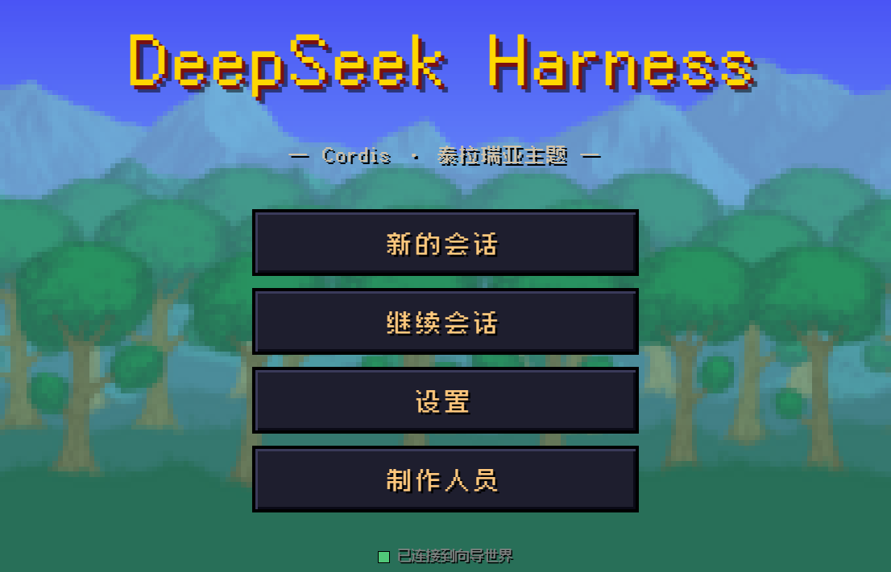
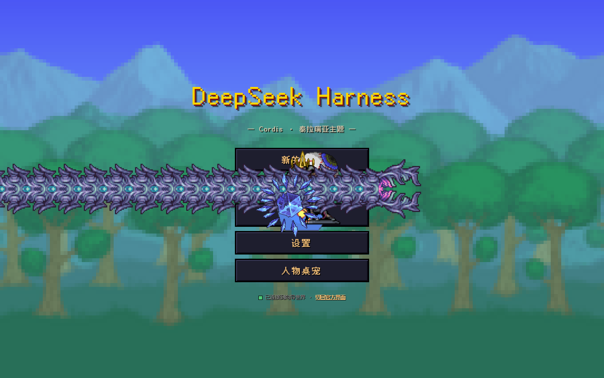
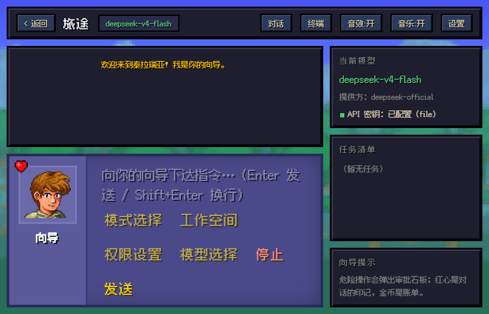
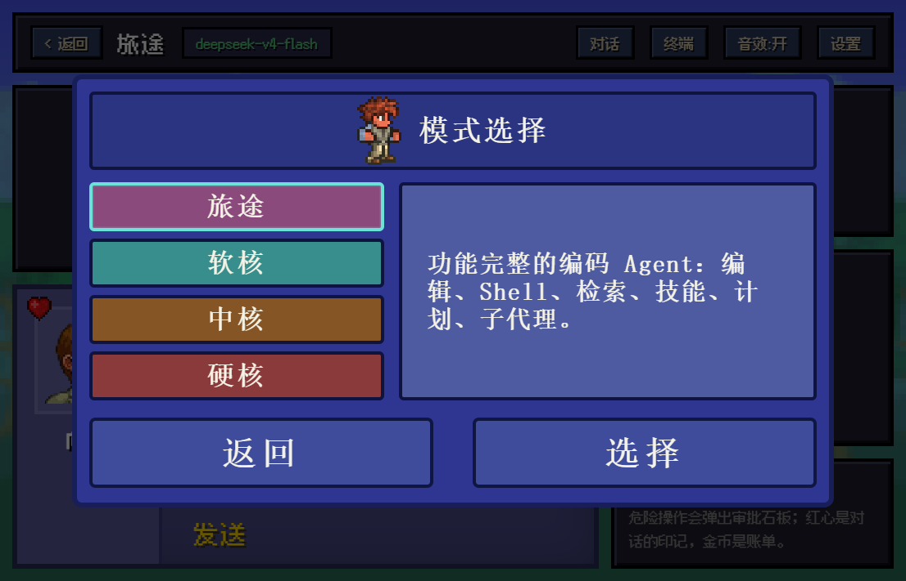
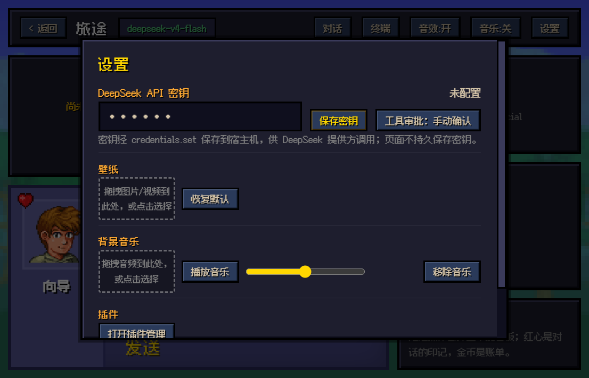
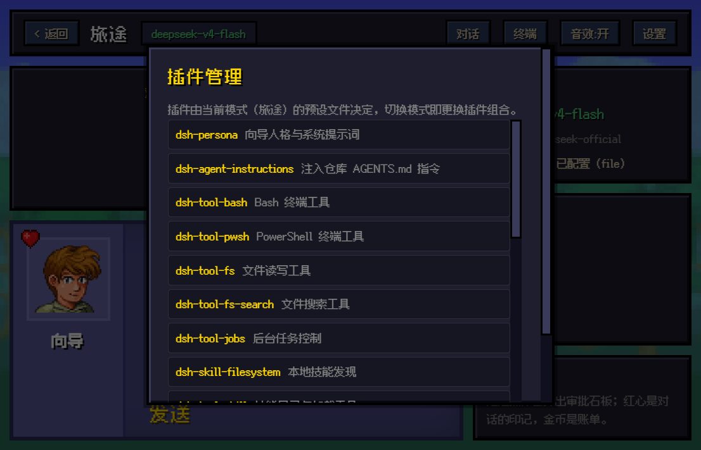
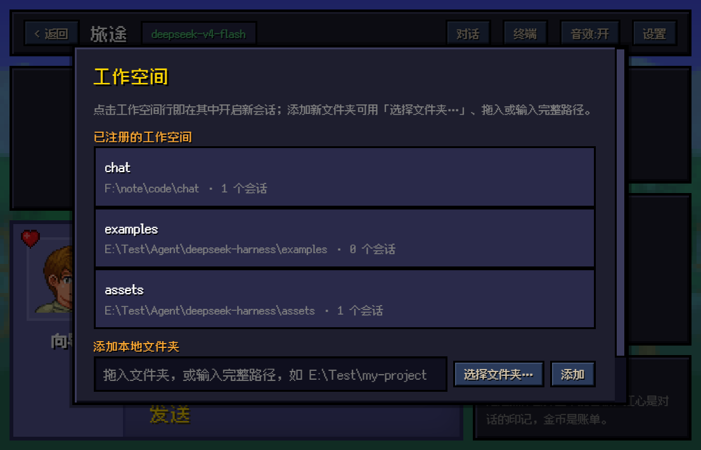
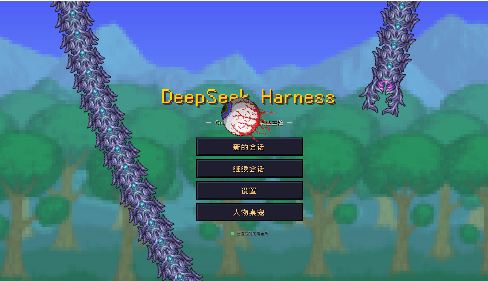
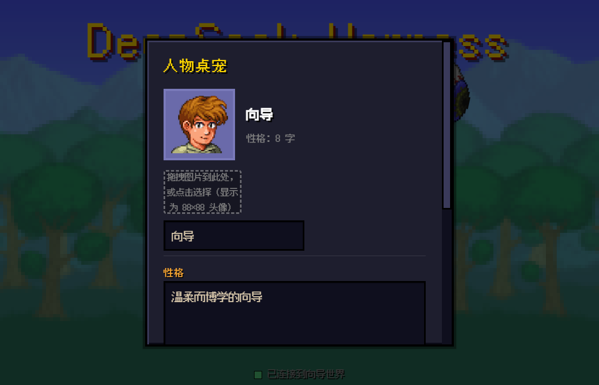

# dsh_theme_terraria

> 把 DeepSeek Harness 的 Web UI 换成一整块泰拉瑞亚（Terraria）像素世界——向导陪你写代码。
>
> [English Version](./README_EN.md)

[](CHANGELOG.md)
[](#2-安装与部署指南含避坑)



---

## 目录

1. [项目概述与核心定位](#1-项目概述与核心定位)
2. [安装与部署指南（含避坑）](#2-安装与部署指南含避坑)
3. [视觉设计系统（UI/UX 细节）](#3-视觉设计系统uiux-细节)
4. [音效交互系统（听觉反馈）](#4-音效交互系统听觉反馈)
5. [隐藏彩蛋（叙事互动）](#5-隐藏彩蛋叙事互动)
6. [性能优化与可访问性护栏](#6-性能优化与可访问性护栏)
7. [项目维护信息（卸载、结构与许可）](#7-项目维护信息卸载结构与许可)

---

## 1. 项目概述与核心定位

**dsh_theme_terraria**（npm 包名 `dsh-theme-terraria`）是 [DeepSeek Harness](https://github.com/deepseek-ai/deepseek-harness)（dsh）的泰拉瑞亚主题插件。它用一个自包含的 `index.html`（约 230 KB，零外部 JS 依赖）替换官方 React 前端，把「AI 编码代理控制台」包装成一场像素冒险：

- **标准 dsh 插件包**：本仓库本身就是一个 npm 包（**已发布到 npm，包名 `dsh-theme-terraria`**）——入口 `index.js` 导出插件规范硬性要求的 `apply(ctx)`，`cordis.patch.yml` 声明 `dsh.bundle` 补丁层。桌面版装进 **desktop profile**，浏览器版装进 web profile；推荐直接按 npm 包名安装（见第 2 节），也支持 GitHub 来源与本地路径，不改动 dsh 安装中的任何文件。
- **不是纯皮肤**：主题直连 dsh 宿主的 JSON-RPC（HTTP 上行）+ WebSocket（事件下行）协议，会话创建、消息发送、流式输出、工具审批、模型切换、工作空间管理全部真实可用。填入 DeepSeek API 密钥即可与模型对话。
- **四个难度档 = 四个 Agent 预设**：旅途（standard，全功能编码代理）、软核（code，Code Mode SDK）、中核（minimal，极简双工具）、硬核（cordis，自定义 preset 模板）。切难度就是切预设，插件的组合随难度实时变化。
- **单文件交付**：整块 UI 内联在一个 HTML 文件里，由插件直接伺服，无任何运行时框架、无构建步骤。

### 核心定位一览

| 官方 UI 概念 | 泰拉瑞亚主题映射 |
|---|---|
| Agent Preset（预设） | 难度档：旅途 / 软核 / 中核 / 硬核 |
| 会话（Session） | 旅途 / 冒险 |
| 用户消息 | 冒险者 |
| 工具审批请求 | 审批石板 |
| 任务清单（todo） | 任务清单 HUD |
| API 密钥状态 | 生命水晶指示灯 |
| 插件组合 | 随难度更换的装备 |

---

## 2. 安装与部署指南（含避坑）

### 环境要求

- 已安装 DeepSeek Harness（桌面应用，或可用的 `dsh` CLI）
- Node.js `^22.19 || >=24` 与 pnpm（`dsh plugin` 内部转发给 pnpm；桌面应用自带运行时，无需另装 Node）
- DeepSeek API 密钥（对话功能必需，其他界面可无密钥浏览）

### 先分清两个 profile：desktop 与 web

| | 桌面应用（Electron） | 浏览器（`dsh web`） |
|---|---|---|
| 插件装到哪个 profile | **`desktop`** | `web` |
| 实际目录 | `~/.dsh/profiles/desktop` | `~/.dsh/profiles/web` |
| 主题怎么生效 | 宿主注入行把窗口接管到 `/terraria/theme.html` | 主题插件替换宿主服务的前端 dist |
| 谁读取这个 profile | 双击启动的桌面应用 | `dsh web` 打印的 URL |

桌面应用**只读 desktop profile**。把主题装进 web profile 不会让桌面窗口出现主题——这是「插件显示已安装，但桌面还是官方界面」最常见的原因。反过来，装进 desktop profile 也不会改变浏览器路径。

### 桌面版安装（推荐：按 npm 包名安装）

> 插件已发布到 npm（包名 `dsh-theme-terraria`），**推荐用应用自带 CLI 按包名安装（无需 git、无需下载源码）**；没有网络或想本地改源码时，再用仓库绝对路径安装。

0. **完全退出应用**（托盘 → 退出），确认进程已消失。profile 在宿主运行时不会重读，注入行也只在启动时快照一次。

   ```powershell
   Get-Process 'DeepSeek Harness' -ErrorAction SilentlyContinue
   ```

1. 安装（三选一，**方式①按 npm 包名最省事**）：

   ```powershell
   # ① 推荐：按 npm 包名安装（已发布，无需 git、无需下载源码）
   & '<DSH 安装目录>\resources\runtime\cli\bin\dsh.cmd' plugin --profile desktop add dsh-theme-terraria
   # 作者本机（D:\dsh）：& 'D:\dsh\resources\runtime\cli\bin\dsh.cmd' plugin --profile desktop add dsh-theme-terraria

   # ② 有 git 时直接从 GitHub 安装：
   # & '<DSH 安装目录>\resources\runtime\cli\bin\dsh.cmd' plugin --profile desktop add github:jiabei20031104/dsh_theme_terraria

   # ③ 没网络 / 想本地改源码：用仓库绝对路径（必须是绝对路径，且目录里有 package.json）
   # & '<DSH 安装目录>\resources\runtime\cli\bin\dsh.cmd' plugin --profile desktop add '<本仓库绝对路径>'
   # 作者本机示例：... add 'D:\code\dsh_theme_terraria-main'
   ```

   - `<DSH 安装目录>` 指 DeepSeek Harness 的安装目录；作者本机是 `D:\dsh`，因此实际命令为 `& 'D:\dsh\resources\runtime\cli\bin\dsh.cmd' …`。装在其它盘符/目录时替换占位符；`dsh` 已在 PATH 时也可直接用 `dsh plugin …`。
   - `where dsh` 为空（没有全局 `dsh` 命令）时，用上面应用自带的等价入口。不要用 `dsh --profile desktop` 去启动宿主——桌面宿主会拒绝这种启动方式；`plugin --profile desktop` 才是被允许的管理入口。
   - 方式②从 GitHub 安装需要本机有 git；**没有 git 时 pnpm 会报 `'git' 不是内部或外部命令`**（实测），请改用方式①的包名或方式③的本地绝对路径。
   - 应用内 **Plugin Hub** 搜索框直接搜 `dsh-theme-terraria` 即可安装；「本地 / Git 来源安装」也可填仓库绝对路径（本地安装同样走 pnpm，不需要 git）。

2. 检查 profile（可选）：

   ```powershell
   Get-Content "$env:USERPROFILE\.dsh\profiles\desktop\package.json"
   ```

   `dependencies` 里应出现 `dsh-theme-terraria`（`link:` 或 `file:`），`dsh.profile.bundles` 末尾应出现 `dsh-theme-terraria`，其他插件保持不变。

3. **正常双击启动应用**。窗口应自动导航到：

   ```text
   dsh-app://app/terraria/theme.html?host=http%3A%2F%2F127.0.0.1%3A19387
   ```

   **装完插件/改完配置必须完整退出并重启应用**：注入行是宿主启动时的一次性快照，只刷新窗口或重载插件不会拿到新行。

4. 卸载（回到官方 UI）：

   ```powershell
   & '<DSH 安装目录>\resources\runtime\cli\bin\dsh.cmd' plugin --profile desktop remove dsh-theme-terraria
   # 作者本机：& 'D:\dsh\resources\runtime\cli\bin\dsh.cmd' plugin --profile desktop remove dsh-theme-terraria
   ```

   卸载后同样**完整退出并重启**应用最稳妥（窗口可能还停在已失效的主题页路由上）。



#### 桌面端工作原理（为什么必须 desktop profile + 重启）

桌面窗口有两个硬限制：主窗口加载的是 `dsh-app://app/`，而这个协议把 `/`、`/index.html`、
`/assets/*` 直接映射到**应用内置**的官方前端，宿主服务的 dist 在窗口里永远不会被请求；只有其余路径才会带上宿主 cookie 转发给宿主。因此主题在桌面端走两条路：

1. **整体接管（默认）**：宿主索引注入行把 `__TERRARIA_THEME__`（主题页地址 + 接管开关）和一段**内联**注入脚本交给窗口；脚本先预检 `/terraria/theme.html`（就是 `web/index.html`），成功才 `location.replace` 过去——桌面窗口里跑的就是网页端那**同一份 UI**：标题屏、向导对话、人物创建、任务 HUD、8-bit 音效、壁纸与桌宠全部一致。`/api/*` 由桌面壳带 cookie 转发，WebSocket 连宿主 origin（地址来自 `__DSH_TRANSPORT__.streamBaseUrl`，注入脚本以 `?host=` 传给主题页）。
2. **兜底皮肤**：主题页不可用（路由缺失 / 预检失败 / 内容不符）或接管被关闭时，官方界面会套上一层注入式像素皮肤（`skin/terraria.css` 覆盖官方 `--dsw-*` 令牌与通用元素样式），不会出现白屏或无限重载。

桌面壳专属适配：原生标题栏配色（preload 读取页面 `--dsw-*` 令牌）；顶栏按窗口控制按钮的实测宽度右侧留白；顶栏与标题屏空白是 `-webkit-app-region: drag`、其中按钮显式 `no-drag`，浮层 `#modal-root` 也是 `no-drag` 并在弹窗打开期间用 `data-terraria-modal` 撤掉底下的拖拽区——否则整屏 drag 区会把浮层点击全部吃掉。

**注入行是宿主启动时的一次性快照**：安装/升级/改配置后必须完整退出并重启应用；只刷新窗口或重载插件无效。

### 浏览器路径（web profile）

浏览器路径需要真实的 `dsh` CLI（应用自带的 `dsh.cmd` 是桌面宿主管理入口，不负责 `dsh web`）：

```sh
# 推荐：按 npm 包名安装（已发布到 npm，无需 git、无需下载源码）
dsh plugin --profile web add dsh-theme-terraria
# 有 git 时也可直接从 GitHub 安装：
# dsh plugin --profile web add github:jiabei20031104/dsh_theme_terraria
# 没网络 / 想本地改源码时，用仓库绝对路径：
# dsh plugin --profile web add '<本仓库绝对路径>'

dsh web
# 默认地址：http://127.0.0.1:3080/
```

- 浏览器路径与桌面窗口互不影响：桌面应用不读 web profile，`dsh web` 也不读 desktop profile。
- `dsh plugin add` 会把 `dsh-theme-terraria` 写入对应 profile 的依赖与 `dsh.profile.bundles` 层列表；本插件的 `cordis.patch.yml` 停用官方 `web-runtime` 行并插入同构的 `terraria-theme` 行，入口 `index.js` 再把官方 `@deepseek-ai/dsh-web-app` 的前端解析器指向本包的 `web/index.html`——除换皮外，官方 Web 运行时的全部行为（dist 伺服、`/api` 信任边界、`DSH_WEB_URL`、URL 打印）保持不变。
- 在 deepseek-harness 仓库内以源码方式运行 dsh 时，给命令加 `pnpm` 前缀（如 `pnpm dsh plugin ...`、`pnpm dsh web`）。

### 开关、退路与共存

| 控制 | 作用 | 用法 |
|---|---|---|
| `DSH_TERRARIA_STANDALONE=0`（或 `off/false/no`） | 不接管窗口，只保留「官方 UI + 像素皮肤」 | 启动应用前设为用户环境变量，或从终端带变量启动 |
| `DSH_TERRARIA_SKIN=0`（或 `off/false/no`） | 连注入的像素皮肤也不加载 | 同上 |
| 主题页标题屏「切回官方界面」/ <kbd>Alt</kbd>+<kbd>O</kbd>（**仅桌面窗口**） | 桌面窗口：写 `localStorage['terraria.takeover']='0'` 并回到官方 UI；**浏览器路径没有官方 UI 可回**，按钮只会重新载入同一主题页 | 桌面窗口内点击或按快捷键；浏览器恢复官方 React 前端请卸载/停用插件（见第 7 节） |
| `localStorage.removeItem('terraria.takeover')` | 重新允许接管（仅桌面窗口有意义） | <kbd>F12</kbd> 控制台执行后 `location.reload()` |

- `DSH_TERRARIA_*` 读的是**宿主进程环境变量**：必须在启动应用**之前**设置（用户环境变量，或从终端启动应用），应用运行中修改无效。
- **浏览器路径恢复官方 UI**：浏览器里的 `/` 就是主题前端本身，没有「官方界面」可切回；请卸载插件（`dsh plugin --profile web remove dsh-theme-terraria`）或停用 bundle，然后重启 `dsh web`。
- **接管会遮蔽客户端插件 UI**：主题页是自包含前端，不加载 `/plugins/*/client.js`，所以 `dsh-dream-skin`、`dsh-whale-widget`、`agent-teams` 的**界面**在接管期间不可见（宿主侧功能仍在运行）。需要它们时设置 `DSH_TERRARIA_STANDALONE=0`，回到「官方 UI + 像素皮肤」。
- **同一 profile 只装一个“换 dist”主题**：两个主题都会 `provide('webRuntime')`。本版本检测到 `webRuntime` 已存在时会跳过委托并 `warn`（注入皮肤与主题页仍可用），不会再让宿主因重复服务启动失败；但界面上只会呈现其中一个主题。
- **信任成本**：安装主题 = 允许注入脚本（约 4 KB）与主题页（约 230 KB）在你以 operator 身份运行的桌面窗口里执行。它们不读取/打印 API 密钥；账号快照只走同源 + 浏览器 cookie 栅栏的 `/terraria/account`。
- **手工打开主题页但没有 `?host`**：页面会向 preload 的 `window.dshDesktopBoot.ready()` 取真实宿主 `streamBaseUrl`；拿不到时会给出可见提示，不会静默去连 `dsh-app://app`，也不会触发无限重载。

### 配置 API 密钥并开始对话

1. 浏览器路径打开 http://127.0.0.1:3080/ （桌面应用里主题页会自动打开，无需手动输地址），点击「新的会话」；
2. 首次进入会自动弹出「设置」——在「DeepSeek API 密钥」输入框填入 `sk-...`，点「保存密钥」；
3. 密钥经 `credentials.set` 存到宿主机（`.dsh-home/.credentials.yaml`），页面本身不持久保存明文；
4. HUD 面板显示「API 密钥：已配置」后，在对话框输入任何指令即可开始真实对话。



### 避坑指南（实测踩过的坑）

| 坑 | 现象 | 解法 |
|---|---|---|
| 插件装上了，桌面窗口仍是官方界面 | Hub/CLI 显示「运行中」，窗口没变 | 主题装进了 **web profile**，桌面应用只读 **desktop profile**；用 `plugin --profile desktop add` 重装，并**完整退出应用再启动**（注入行是启动时的一次性快照） |
| `dsh` 不是内部或外部命令 | `where dsh` 为空、命令找不到 | 用应用自带入口：`& '<DSH 安装目录>\resources\runtime\cli\bin\dsh.cmd' plugin --profile desktop …`（作者本机为 `D:\dsh`） |
| Hub/CLI 安装报 `'git' 不是内部或外部命令` | 用 `github:` / `git+https:` 安装失败 | 本机没有 git：直接用 **npm 包名** `dsh-theme-terraria` 安装（方式①，无需 git），或改用本地绝对路径 |
| 按包名安装找不到包 / 404 | registry 被解析到只读镜像源或网络问题 | 确认能访问 `registry.npmjs.org`，或在插件管理器「安装源」里切到官方源；仍失败就改用 GitHub 来源或本地绝对路径 |
| 桌面窗口里看不到主题、连接一直转圈 | 停在主题页但连不上宿主 | 标题屏点「切回官方界面」或按 `Alt+O` 先回到可用界面，再把 <kbd>F12</kbd> 控制台的报错发出来；手工打开主题页时确认 URL 带 `?host=` |
| 接管后鲸鱼挂件 / AgentTeams / dream-skin 的界面消失 | 这些插件的客户端 UI 不见 | 预期行为：主题页不加载 `/plugins/*/client.js`。需要它们时在启动应用前设 `DSH_TERRARIA_STANDALONE=0`（官方 UI + 像素皮肤） |
| 同时装了两个“换 dist”主题 | 只有一个主题生效，日志出现 webRuntime 警告 | 同一 profile 只留一个；本版本检测到 `webRuntime` 已存在会跳过委托、不会崩宿主，但界面只呈现先挂载的主题 |
| 浏览器缓存旧 UI | 更新插件后页面还是旧样子 | 强制刷新 `Ctrl+F5`，或地址加 `?v=2` 绕过缓存 |
| `dsh plugin add` 失败 | 报 `pnpm not found on PATH` 或 pnpm 错误 | `dsh plugin` 内部转发给 pnpm：安装 pnpm 并重开终端；git 方式安装的报错按提示在 profile 的 `pnpm-workspace.yaml` 补 `allowBuilds` 后重试 |
| 密钥保存失败 | toast 报「保存失败」 | 确认 `dsh web` 由本机终端启动；沙箱化环境可能拦截宿主目录写入 |
| 图片壁纸存不下 | 「图片过大，保存失败」 | localStorage 上限约 5 MB，主题已自动把非 GIF 图片压缩到 1920px JPEG；仍失败请换更小的图或用视频壁纸 |
| 文件夹选择器拿不到完整路径 | 选择文件夹后只有文件夹名 | 浏览器安全限制（所有网页一致），主题会用「使用 E:\完整\路径」按钮智能回填已注册的同名目录，否则提示手动补全；**桌面应用里没有这个限制**：直接调 preload 的原生目录选择器，返回的就是完整路径 |
| 顶栏的「音效 / 音乐 / 设置」被窗口控制按钮压住 | 桌面窗口右上角的最小化/最大化/关闭盖住按钮，且点不动 | 顶栏按 `titlebar-area` 实测宽度右侧留白让按钮左移；拖动区改成顶栏 + 标题屏的 `-webkit-app-region`（按钮 `no-drag`），不再用整条拖拽带吞点击。改完需重载页面（见下一条） |
| 弹窗里的按钮（「关闭」等）点了没反应 | 桌面窗口停在标题屏时，整屏 drag 区把浮层的点击全吃掉 | 浮层 `#modal-root` 显式 `no-drag`，弹窗打开期间再用 `data-terraria-modal` 撤掉底下的拖拽区；<kbd>Esc</kbd> 也能关弹窗。改完需重载页面（见下一条） |
| 改了主题页看不到效果 | 桌面应用里没有刷新快捷键（Windows 上应用菜单只有 F12 开发者工具） | 设置弹窗里点「重新载入界面」，或 <kbd>F12</kbd> 后在控制台执行 `location.reload()`；注入行变更才需要完整重启应用 |
| WebSocket 断线 | 顶部提示「连接已断开，重连中…」 | 属正常自动重连（2 秒间隔）；宿主进程退出则需重启 `dsh web` |

---

## 3. 视觉设计系统（UI/UX 细节）

### 设计语言：像素三原色 + 石板质感

整个 UI 的视觉基调由三层构成：

1. **背景层**：默认森林壁纸（`forest.png`）+ 标题屏大树（`Tree.png`），`image-rendering: pixelated` 保持像素锐利；支持用户更换（见壁纸系统）。
2. **面板层**：所有卡片/弹窗使用「泰拉瑞亚石板」风格——深蓝双层嵌套（外框 `#181e58`，内板 `#2e3692`）、3 px 深色描边（`#0e1340`）、8 px 圆角、宋体加粗（`SimSun/Songti SC`）。
3. **点缀层**：金色（`--gold`）标题与高亮、火把橙（`--torch`）分区标题、羊皮纸白（`--parchment`）正文，配深色投影 `text-shadow: 1px 1px 0 var(--black)`。

### 字体系统

- 主字体：**Fusion Pixel 12px**（缝合像素，开源中文像素字体），单文件 `woff2` 约 600 KB，内嵌于 `web/` 目录，中文渲染无锯齿；
- 弹窗标题：宋体加粗，还原游戏原版点阵字感；
- 等宽：终端面板使用 monospace 呈现工具输出。

### 标题屏

游戏主菜单复刻：logo、五个像素菜单项（新的会话 / 继续会话 / 插件管理 / 设置 / 人物桌宠）、森林背景上的大树剪影。

### 主对话界面（三栏布局）

- **顶栏**：返回按钮、会话名（显示当前**工作空间名**，如 `dsh_theme_terraria`；会话没挂工作空间时退回模式名）、连接状态灯（「已连接到向导世界」）、对话/终端双标签切换、音效开关、音乐开关、插件管理、设置入口。模型名只在 HUD「当前模型」里显示，顶栏不再重复挂一个徽章；
- **对话区**：消息流（冒险者 = 用户、向导 = 助手）+ 底部 NPC 对话框——左侧向导立绘头像（`xiangdao.png`）与红心印记（`heart.png`），右侧输入框与七个像素按钮：**附件、模式选择、工作空间、权限设置、模型选择、停止、发送**。**一个回合只留一行「过程」+ 一条结果回复**：思考原文、工具调用、中间步骤正文（「Now the endpoint mapping:」这类过渡话）全部收进可折叠的过程块——运行中展开看得见进度，回合结束自动收起成一行摘要（如「过程 · 已思考 1.1k 字 · 7 次工具 · 3 段中间说明 · 24s」）。于是聊天流里只有你的消息、每个回合一行过程摘要和结果气泡；**没有正文的步骤不留任何气泡**（以前会留下只有一行 token 统计或「已思考 · N 字」的砖块）；
- **思考过程进过程块**：点开摘要行即可看思考原文（带「已思考 · N 字」标签）与每一步的工具调用；工具活动同时镜像到「终端」标签。运行中仍然只显示一行「••• 正在思考…」；
- **回复底下不再有 tokens 行**：以前每条回复下方都挂一行「tokens: … + 缓存 … → 输出 …（合计 …）」，现在聊天流里**完全不出现 token 文案**，用量只在 HUD 的速率面板里看（见下一条）；
- **HUD 侧栏**：当前模型（名称+描述）、登录状态灯（账号登录时显示「DeepSeek 账号：已登录」，否则显示「API 密钥：已配置 / 未配置」；这里**只有状态，没有登出入口**，「退出登录」放在设置弹窗的登录角色一行）、任务清单（todo 实时投影）、向导提示——**token 统计的唯一出口**（**输出速率**：实时速率 + 本回合用量 + 会话均值 + 迷你条形图，每步的 `outputTokens` 都在这里累计）。

### 聊天记录：历史翻页 + 锚点导航 + Markdown

- **历史翻页（「继续会话」里再也丢不掉自己的提问）**：`session/follow` 的 snapshot 只是一窗（实测约 300 条、可能只含最近一次提问），所以 `loadHistory()` 接着用 `session/page`（`throughSeq` 含 / `beforeSeq` 不含）**自动往前翻 4 页**；翻不完的在消息区顶部与导航面板留「⬆ 加载更早的历史」按钮（一次最多再翻 12 页 / 6000 条）。加载后按时间序重排，并按高度差补偿保持原来的阅读位置；
- **锚点导航**：对话区右上角「≡ 导航」打开浮层，把已加载的**结果**列成锚点（冒险者 = 你的每条要求、向导 = 有正文的回复，带文本预览），点一下跳到那条消息并闪金边；带筛选框（按文本过滤）、⬆/⬇ 跳最早/最新，滚动时自动高亮「当前读到哪条」；
- **只记结果**：只带「思考过程」或只有 tokens 行的中间步骤（模型分步但没产出正文的那些砖块）**不进聊天记录清单**，免得清单里全是没法跳的流水；
- **Markdown 渲染**：助手回复按 Markdown 渲染（标题、粗斜体、行内代码、围栏代码块 + 一键复制、引用、有序/无序/任务列表、表格、分隔线、链接与图片），流式输出过程中也实时渲染；渲染前先做 HTML 转义，模型输出的标签不会被执行；用户消息保持纯文本 `pre-wrap`。



### 对话框附件（图片 / 文件 / 截图）

输入框上方的草稿附件栏 + 三条入口，走的是官方 UI 同一套协议：

- **入口**：「附件」按钮（多选文件）、<kbd>Ctrl</kbd>+<kbd>V</kbd> 粘贴截图、把文件拖进输入区；
- **图片**（PNG/JPEG/WebP/GIF）读成 base64，以 `{ type:'image', mediaType, data, name }` 内联送出，
  其它格式的位图先用 canvas 转 PNG；草稿栏显示 56px 缩略图；
- **其它文件**先 `POST /api/session/uploadFileBinary?sessionId=&name=`（`application/octet-stream`）
  拿到 `receiptId`，再以 `{ type:'file', receiptId }` 送出；草稿栏显示文件卡（名字 + 大小 + 上传状态）；
- 发送前若有附件还在读取/上传，会提示等待；上传失败的那一条标红并阻止发送（可点 × 移除）；
- 送出的气泡里保留缩略图/文件名回执；
- 文件夹本身不是附件：拖入文件夹会提示改用「工作空间」（DSH 的附件协议只接受文件字节）。

### 模式选择弹窗：人物创建界面 1:1 复刻

点击「模式选择」弹出泰拉瑞亚**人物创建**风格弹窗（这是全主题最还原的一处）：

- 顶栏：行走人物 gif（`Style_1_male_walking.gif`）+ 「模式选择」标题；
- 左列四个难度按钮，各自的游戏配色——旅途（紫 `#8a4b7c`）、软核（青 `#388e8d`）、中核（棕 `#855526`）、硬核（红 `#8a3a3b`）；
- 选中态：亮青色外框（`#6be1d8`）+ 内侧微光描边；
- 右侧说明面板实时显示所选难度的真实预设描述；
- 底部「返回 / 选择」大按钮，按下有 `scale(0.96)` 缩放反馈；
- 点「选择」即真实调用 `agentPreset.select` 切换后端预设；顶栏会话名显示当前工作空间名。

### 继续会话弹窗：工作空间为父、会话为子

标题屏「继续会话」按**文件夹树**排会话（`session/list` + `workspace/follow` 两份数据对齐）：

- **父节点 = 工作空间**：标题行显示工作空间名（如 `dsh_theme_terraria`）+ 完整路径 + 会话数，点一下折叠 / 展开（`▾ / ▸`）；
- **子节点 = 第 x 个对话**：组内按最近活动倒序，第 1 个就是最新的那个，行里带会话标题、时间、`运行中` 标记与工作目录；
- **归档**：每个会话行尾一个「归档」按钮，调用 `workspace/archiveSession`（正在运行的会话会一并停止它的运行）；归档后的会话不再出现在工作空间树下，而是收进底部**「已归档」**父节点，那里每行是「取消归档」（`workspace/unarchiveSession`），放回原工作空间；
- **归档区不会自动展开子对话**：它每次打开「继续会话」都以收起态出现（展开状态只活在这个弹窗里，不写入会话组共用的折叠记忆）；里面只列**真正的对话**——`origin === 'subagent'` 或带 `parentSessionId` 的子智能体会话不入列，它们的父对话归档时一起进了归档集，之前正是它们把这一栏撑成一长串「第 x 个对话」；
- 会话归属以 `workspace/follow` 的 `sessionIds` 为准，`cwd` 命中工作空间路径时兜底补上；两份数据都没覆盖到的会话按 `cwd` 尾段各自成组，没有 `cwd` 的落到「未归入工作空间」；
- 某个工作空间的对话全部归档（或不再可见）后，这个父节点就不再出现在树上（`children.length > 0` 才建组），「删完 / 归档完父对话也就消失」由此成立；DSH 官方接口没有「删除单个会话」，所以这里不提供删除按钮——归档就是收起对话的入口。

### 设置弹窗与壁纸系统

设置弹窗分四区（原来「插件」区已独立成顶栏的「插件管理」按钮）：

- **登录角色**（第 0 行，`#set-role` / `#set-role-detail`）：显示当前用哪种身份在跑——「DeepSeek 账号 · 已登录 · <昵称或联系方式>」或「API 密钥 · 未登录 DeepSeek 账号，用密钥直连」，账号登录时补充一句「凭据由宿主保管并自动用于模型调用，无需再填写 API 密钥」。数据来自同源 `GET /terraria/account`（宿主侧主题插件问账号服务 `getState` / `getProfile`，只投影昵称、联系方式与头像）。**账号登录时这一行右侧还有「退出登录」按钮**（`#set-signout`，`btn-danger` 小按钮）：点击先弹确认框（弹框前查 `account/hasRunningAccountTasks`，有任务在跑就写明会打断、查不到就按未知措辞），确认后走宿主的 `account/signOut`（客户端身份 `{version, locale, timezoneOffsetSeconds}`，与官方前端同一端点）——宿主删掉本机账号凭据、在后台向 Platform 吊销授权，**API 密钥不受影响**；退出后页面轮询 `/terraria/account` 直到不再是账号登录，角色与 HUD 状态灯就地刷新。密钥模式下按钮隐藏（没有可退的登录）。**这个按钮只属于设置弹窗，对话页（HUD / 顶栏）不显示它**；
- **API 密钥**：橙色标题「DeepSeek API 密钥」+ 右侧配置状态；密码框居左（起点位置与高度不变，宽度自适应），同一行右侧依次是金色「保存密钥」按钮与工具审批模式开关（自动允许 / 手动确认），三者底边对齐；`credentials.set` 存宿主；窄屏下按钮自动换行不遮挡输入框；
- **壁纸**：虚线拖拽框「拖拽图片/视频到此处，或点击选择」——支持拖拽与点击两种上传；图片自动压缩到 1920px JPEG 存 localStorage，GIF 原样保留动画，**视频（MP4/WebM，≤512 MB）存 IndexedDB 作为全屏动态壁纸**（静音循环、垫底）；「恢复默认」一键回到森林壁纸；
- **背景音乐**：虚线拖拽框「拖拽音频到此处，或点击选择」——支持拖拽与点击上传任意音频（MP3/WAV/OGG 等，≤64 MB），存 IndexedDB 后循环播放；配「播放/暂停」按钮、音量滑块与「移除音乐」；顶栏「音乐:开/关」随时切换；
- **界面**：重新载入界面（桌面壳里没有刷新快捷键），以及打开插件管理。



### 插件管理（搜索 / 检查 / 安装 / 启停 / 卸载）

顶栏「插件管理」（标题屏菜单里也有）打开插件弹窗，走宿主 `pluginManager` 服务：

- **搜索**：直接问公开 npm registry（`registry.npmjs.org/-/v1/search`，带 CORS），dsh 相关的结果自动排前面；空关键词按 `keywords:dsh-plugin` 搜；搜索不可用时提示直接粘贴包名；
- **本地 / Git 来源安装**（搜不到就靠它）：一行输入框 + 「选择文件夹…」（桌面壳走原生目录选择器，直接给出宿主绝对路径）、「选择 .tgz…」（`__DSH_HOST_PATHS__.pathFor`）、也可以把文件夹**拖进这一行**；支持宿主的全部 spec 形态——绝对路径（`D:\code\my-plugin`，目录里要有 package.json）、`*.tgz`（本地或 URL）、git 仓库（`github:你/仓库`、`https://github.com/你/仓库`、`git+https://…`、`git@host:path`）、registry 包名（可带 `@版本`）。**本地路径必须是绝对路径**：`file:///D:/…` 与相对路径都会被宿主拒绝（实测 host 报 `not-a-package: the path does not exist` / `invalid-spec: a local path must be absolute`）；
- **检查**：`pluginManager/inspect` 先解析 spec（包名 / npm 别名 / git 地址 / 本地路径 / tarball），显示它是不是 bundle、版本与描述；被拒绝时给出 `problem` 与原因（如 `not-found` + registry 报错原文、`already-installed`）；
- **安装**：`pluginManager/installBundle`（带客户端生成的 `requestId`，`enabled: true`），结果按 `application` 区分 `applied / restart-required / failed`，失败时附错误码、诊断与 pnpm 输出尾部；安装日志区也会收集宿主推来的 `plugin-manager/install-log`；
- **已安装**：`pluginManager/listBundles` 列出全部 bundle（名称 @ 版本 · 标题 · 描述），行尾可**启用 / 停用**（`setBundleEnabled`）、可卸载的还能**卸载**（`removeBundle`）；内置 bundle 标「内置（不可卸载）」并禁用开关；bundle 内含多个插件时列出插件名；
- **安装源**：显示 `pluginManager/registries` 解析出来的源（本机是 `registry.npmjs.org` + 回退 `registry.npmmirror.com`）；
- **当前模式的插件清单**：原来设置里的 cordis.yml 清单也挪到这里了，可展开原始预设文件对照。

#### 为什么 GitHub 上的插件在搜索里搜不到

搜索查的是 **npm registry 的索引**，不是 GitHub。所以：

1. **只在 GitHub 上有仓库、没发布到 npm** 的插件，registry 里根本没有它的元数据，搜不到是必然的（`pluginManager/inspect` 会直接告诉你 `not-found`）；
2. 发布过、但**名字和描述里没有 `dsh` 关键词**的包，按关键词搜时排在很后面（搜索用的是相关性排序，不是精确过滤）；
3. 装的是**私有 registry / 内部源**里的包时，公开 registry 同样看不到它（本机解析出的源是 npmjs + npmmirror 回退）；
4. **scoped 包**（`@you/pkg`）经常要靠精确名字才搜得到。

装法不受影响：把仓库地址填进「本地 / Git 来源安装」即可（`https://github.com/你/仓库`、`github:你/仓库`，
实测 `inspect` 返回 `{status:"accepted",kind:"git",host:"github.com"}`）；本地检出目录填绝对路径，
打包好的填 `*.tgz` 路径。pnpm 会自己 clone / 解包 / 装依赖。



### 工作空间弹窗

- 列出所有已注册工作空间（标题、完整路径、会话数），**点击任一行即在该目录开启新会话**（会话名显示该工作空间名，如「assets」）；
- 「添加本地文件夹」支持三种方式：**选择文件夹…**、**拖拽**、**手动输入**完整路径；
- 桌面壳（Electron）里「选择文件夹…」直接用 preload 的原生目录选择器（`__DSH_DIRECTORY_PICKER__`）、
  拖入的文件夹用 `__DSH_HOST_PATHS__.pathFor(file)` 取真实宿主路径，两者都**一步拿到完整路径**；
  浏览器里没有这两个能力，退回 `webkitdirectory` + 「使用 E:\完整\路径」智能回填已注册同名目录。



### 人物桌宠

标题屏「人物桌宠」打开，可以替换对话区里陪伴你的人物，并控制屏幕上游荡的五只桌宠：

- **头像上传**：拖拽或点击选择图片（≤16 MB，任意尺寸），显示为 88×88 方形头像（`object-fit: cover` 居中裁切）；存 IndexedDB，刷新后自动恢复；照片平滑渲染，默认像素画保持 `pixelated` 锐利；
- **名字编辑**：输入新名字（≤12 字，失焦或回车保存），同步更新对话区名牌、聊天气泡署名、审批石板（「XX想要使用工具」）、提问弹窗标题、欢迎语与输入框 placeholder；
- **性格设定**：文本域直接编辑，或从 `.md` / `.markdown` 文件导入（拖拽或点击，≤512KB）；导入时显示金色进度条，内容自动做去 BOM、统一换行、去首尾空白、64K 字符截断处理后入库；悬停对话区头像可速览性格前 120 字；
- **桌宠开关（五只独立控制）**：每只桌宠一个像素 toggle 开关——**克鲁苏之眼**（游荡旋转的浮空巨眼）、**史莱姆王**（蹦跳带挤压变形的史莱姆）、**嘉登**（帧动画飞行的机械师）、**神明吞噬者**（多节段跟随爬行的蠕虫）、**极地之灵**（旋转飞行的冰晶）；每只桌宠一个独立整屏透明 iframe（`pointer-events` 穿透不挡任何操作），尺寸统一 160px 标准（嘉登 133×160 保持 5:6 比例）；显示/隐藏带 0.5s 淡入淡出过渡；每只的开关状态独立存 localStorage（`terraria.pet.<id>`），刷新保持；宿主页与各 iframe 之间以 postMessage 通信（`dsh:pet` pause/resume 命令 + `dsh:pet-ack` 确认 + `dsh:pet-ready` 就绪握手，按 contentWindow 识别来源），关闭某只即冻结其动画循环省 CPU，互不影响；
- **恢复默认**：一键清掉自定义头像、名字与性格，回到向导与默认像素画。





---

## 4. 音效交互系统（听觉反馈）

主题内置一套 **8-bit 风格 WebAudio 音效引擎**——纯振荡器合成（方波），无音频文件、零网络请求：

| 事件 | 频率/时长 | 听感 |
|---|---|---|
| 助手回复完成（`assistant/message`） | 660 Hz / 60 ms | 短促「叮」，像拾取金币 |
| 工具审批请求 | 440 Hz / 100 ms | 中音提示，唤起注意 |
| 向用户提问（ask_user） | 520 Hz / 100 ms | 上扬询问音 |
| 回合失败 / 发送失败 | 180 Hz / 100 ms | 低沉「咚」，受伤音效 |

设计原则：

- **克制**：每个事件只响一声，绝不循环轰炸；流式输出过程（token 逐字到达）完全静音；
- **可关**：顶栏「音效:开 / 音效:关」一键切换，状态存 localStorage，刷新保持；
- **降级安全**：`try/catch` 包裹整个播放流程，无声环境（自动播放策略拦截、无音频设备）静默忽略，绝不抛错。

### 背景音乐（自定义 BGM）

与音效引擎相互独立的一套自定义 BGM：

- **上传**：设置弹窗中拖拽或点击选择音频文件（MP3/WAV/OGG/FLAC/M4A/AAC/OPUS，≤64 MB），存 IndexedDB（与视频壁纸同一库，绕开 localStorage 5 MB 上限），刷新后自动恢复；
- **播放**：`<audio>` 循环播放；音量滑块 0–100 实时调节并存 localStorage；顶栏「音乐:开/关」与设置内「播放/暂停」双向同步文字状态；
- **自动播放策略**：浏览器要求出声前先有一次页面交互——若刷新后音乐没有自动响起，点击页面任意位置即恢复播放；
- **卸载**：「移除音乐」清空 IndexedDB 中的 BGM 并停止播放，回到无声世界。

---

## 5. 隐藏彩蛋（叙事互动）

主题在交互细节里埋了一套贯穿始终的**冒险叙事**，细心的玩家会陆续发现：

1. **开场白**：每次新会话，消息区第一行是——「欢迎来到泰拉瑞亚！我是你的向导。」（改过人物名字后跟着叫新名字）
2. **你的名字是「冒险者」**：所有用户消息的署名都不是「我」或「User」，而是冒险者——向导对面站着的人。
3. **HUD 向导提示**（随机暗示玩法）：「危险操作会弹出审批石板；红心是对话的印记，金币是账单。」——红心 = 对话气泡的印记装饰，金币/账单 = 每轮回复附带的 token 用量统计。
4. **连接状态的世界观**：联网成功显示「已连接到向导世界」，断线显示「连接已断开，重连中…」——把 WebSocket 重连讲成了世界联结。
5. **难度档的语言体系**：模式选择里没有「standard/code/minimal」，只有旅途、软核、中核、硬核；选中软核时右侧说明是游戏原文「软核人物死亡时会掉落金钱。」——而它实际切换的是 Code Mode SDK 预设。
6. **「旅程被中断」**：你手动停止一次生成时，系统行不写「已取消」，写「旅程被中断」。
7. **人物桌宠**：标题屏「人物桌宠」点开可以换掉对话区里的人物——拖拽或点击上传照片作头像（任意尺寸，显示为 88×88，照片平滑渲染、像素画保持锐利），改名后聊天气泡署名、审批石板、欢迎语、输入框提示全部跟着换人；「性格」区可手写或从 .md 文件导入人物性格设定；「桌宠」区五只桌宠各有独立 toggle 开关——克鲁苏之眼、史莱姆王、嘉登、神明吞噬者、极地之灵，想让谁陪跑就放出谁，也可以全员出动在屏幕上开一场 Boss 巡游。
8. **行走的旅人**：模式选择弹窗顶栏那个一直在走的小人 gif——他永远在走，像在等你选好难度一起出发。

---

## 6. 性能优化与可访问性护栏

### 性能优化

| 优化点 | 做法 |
|---|---|
| **零框架运行时** | 整个 UI 是原生 DOM 操作，无 React/Vue 运行时；构建产物仅一个约 230 KB HTML + 静态资源 |
| **像素字体单文件** | Fusion Pixel woff2 一次加载全站复用，无 FOIT 闪烁（`font-display` 由浏览器默认 swap） |
| **壁纸自动压缩** | 上传图片统一缩放到最长边 1920px、JPEG 质量 85%，localStorage 存量可控 |
| **视频与音乐走 IndexedDB** | 动态壁纸（≤512 MB）与自定义 BGM（≤64 MB）都存 IndexedDB，绕开 localStorage 5 MB 上限；`URL.createObjectURL` 引用，更换时 `revokeObjectURL` 释放内存 |
| **渲染锐利而便宜** | `image-rendering: pixelated` 让低分辨率素材放大不加滤镜，GPU 开销近乎为零 |
| **消息流局部更新** | 流式输出只改一个气泡的 `textContent`，不重排整列表 |

### 可访问性护栏

- **对比度**：全部正文为深底浅字（`#f4f3e6` 级别羊皮纸白 on `#2e3692` 深蓝），关键操作（发送/保存）用金色按钮强调；
- **听觉可关**：音效系统整体开关，不强制听觉反馈；
- **审批护栏**：工具默认手动确认——危险操作弹出审批石板需要人点头，自动允许是显式 opt-in 且按钮上带「谨慎使用」警告；
- **容错降级**：IndexedDB 不可用时视频壁纸静默退回静态壁纸；WebSocket 断线自动重连并明确告知状态；所有 RPC 失败都有 toast 提示而非静默吞错。

---

## 7. 项目维护信息（卸载、结构与许可）

### 目录结构（标准 dsh 插件包）

```
dsh_theme_terraria/       <- 本仓库 = 一个标准 dsh 插件包（可直接上传 GitHub）
├── package.json          <- 插件清单：包名 dsh-theme-terraria、main 入口、
│                            dsh.bundle 补丁声明、peer 依赖、files/exports
├── index.js              <- 插件入口：导出 apply(ctx)；替换前端 dist 解析器、
│                            注册 /terraria/* 皮肤资源路由、推送索引注入行
├── cordis.patch.yml      <- bundle 补丁层：停用官方 web-runtime，插入 terraria-theme 行
├── skin/                 <- 注入层（宿主索引注入表）与兜底皮肤
│   ├── terraria.js           注入层：预检并把桌面窗口接管到主题页（内联进索引）
│   └── terraria.css          兜底皮肤：官方界面的令牌与像素化样式
├── web/                  <- 插件伺服的主题前端 dist（浏览器打开宿主 URL 时的完整 UI）
│   ├── index.html            主题全部源码（HTML + CSS + JS 单文件）
│   ├── forest.png            默认森林壁纸（内容是 WebP，皮肤按真实类型发送）
│   ├── Tree.png              标题屏大树
│   ├── xiangdao.png          向导头像立绘
│   ├── heart.png             红心印记
│   ├── Style_1_male_walking.gif  行走人物（模式弹窗）
│   ├── fusion-pixel-12px.woff2   像素字体
│   ├── favicon.svg           站点图标
│   ├── eoc_pet.html          克鲁苏之眼桌宠（iframe 内容页，含 postMessage 通信）
│   ├── slimeking_pet.html    史莱姆王桌宠（iframe 内容页，含 postMessage 通信）
│   ├── draedon_pet.html      嘉登桌宠（iframe 内容页，含 postMessage 通信）
│   ├── dog_pet.html          神明吞噬者桌宠（iframe 内容页，含 postMessage 通信）
│   ├── cryogen_pet.html      极地之灵桌宠（iframe 内容页，含 postMessage 通信）
│   └── manifest.webmanifest  PWA 清单
├── asset/                <- 立绘与 BGM 素材（随包发布）
├── screenshots/          <- 实操截图（9 张，含真实 Electron 桌面壳仿真）
│   ├── title-screen.png      标题屏
│   ├── chat-main.png         主对话界面
│   ├── mode-select.png       模式选择弹窗（人物创建）
│   ├── settings.png          设置弹窗（密钥/壁纸/插件）
│   ├── plugin-manager.png    插件管理器
│   ├── workspace.png         工作空间弹窗
│   ├── desktop-title-screen.png  Electron 桌面壳仿真：接管后的主题标题屏
│   ├── desk-pet.png          桌面窗口：人物桌宠弹窗
│   └── desk-pet1.png         桌面窗口：标题屏 + 桌宠巡游
├── docs/
│   └── GITHUB_UPLOAD.md  <- 上传清单、仓库设置、Release 文案与用户操作步骤
├── README.md             <- 中文文档（本文件）
├── README_EN.md          <- English documentation
├── CHANGELOG.md          <- 版本与兼容性变更记录
└── .gitignore            <- 排除 .analysis/、.agent-teams/、日志与本地凭据
```

### 插件规范要点（apply(ctx) 与加载方式）

- **入口模块**：`package.json` 的 `main` 指向 `index.js`，其中导出 `name`（`'terraria-theme'`）与 `apply(ctx, config)`——导出 `apply(ctx)` 是 DeepSeek Harness 插件规范的硬性要求，也是 `dsh plugin add` 能正确加载本主题的原因；
- **apply(ctx) 做什么**：三件事。其一注册 `/terraria/*` 路由（`/terraria/theme.html` 就是 `web/index.html`，`/terraria/account` 是带同源 + cookie 栅栏的账号快照），并向宿主的索引注入表（`webserver/index-inject`）推入样式行、`__TERRARIA_THEME__` 全局与**内联**注入脚本行——**桌面应用窗口**靠这一路把窗口接管到主题页，跑的是同一份 UI；其二把官方 `@deepseek-ai/dsh-web-app` 的 dist 解析器（`WebApp.internals.resolveDistIndex`）指向本包的 `web/index.html` 再委托挂载官方插件——浏览器打开宿主 URL 时拿到完整主题前端；其三对委托做**降级保护**：`webRuntime` 已被别的主题提供、peer 解析/导入失败时只保留前两条路，不把宿主启动打崩；
- **注入行为什么是内联**：桌面壳对 `script-src` 是 `await loadScript(src)`，该脚本 404/网络失败会 reject `__DSH_BOOT_READY__`，让整个窗口（连同官方 UI）起不来。内联 `script` 行由壳直接执行，`/terraria/terraria.js` 只作为手工调试的只读路由保留；
- **补丁层**：`package.json` 声明 `"dsh": { "bundle": { "patch": "./cordis.patch.yml" } }`，`dsh plugin --profile <desktop|web> add` 安装时据此把本包加入对应 profile 的 `dsh.profile.bundles` 层列表；
- **peer 依赖**：`@deepseek-ai/dsh-web-app >=0.1.0-rc.5`（下界开放），由 dsh 安装侧统一解析。解析按“进程入口 → loader baseUrl”顺序逐个校验 `internals.resolveDistIndex` 是否存在，命中旧副本会自动继续下一个锚点，保证与官方 Web 运行时共享同一份 cordis 实例。

### 常用维护命令

```powershell
# 修改主题：直接编辑 web/index.html 或 skin/（无构建步骤）
# 浏览器路径：重启 dsh web 生效
# 桌面路径：改完配置/插件后必须完整退出并重启应用（注入行是启动快照）

# 更新已安装的主题插件（桌面版示例；浏览器路径把 desktop 换成 web）
& '<DSH 安装目录>\resources\runtime\cli\bin\dsh.cmd' plugin --profile desktop update dsh-theme-terraria
```

### 卸载主题（恢复官方 UI）

```powershell
# 桌面版（先完全退出应用，再执行；之后重启应用）
& '<DSH 安装目录>\resources\runtime\cli\bin\dsh.cmd' plugin --profile desktop remove dsh-theme-terraria
# 作者本机：& 'D:\dsh\resources\runtime\cli\bin\dsh.cmd' plugin --profile desktop remove dsh-theme-terraria

# 浏览器版
dsh plugin --profile web remove dsh-theme-terraria
dsh web   # 重启后即恢复官方 React 前端
```

主题通过插件机制整体挂载/卸载，不修改 dsh 安装中的任何文件，卸载零残留。浏览器端的个性化数据（壁纸、背景音乐、音效开关、审批偏好）都存在浏览器 localStorage / IndexedDB，清除站点数据即可完全抹掉；桌面窗口的 localStorage 属于 `dsh-app://app` origin，卸载主题后仍保留，需要时用 <kbd>F12</kbd> 控制台清理 `terraria.*` 键。

### 提交收录与发布

- 在 GitHub 仓库 **Topics** 中添加 `dsh-plugin`——收录爬虫据此识别本仓库是一个 DSH 插件；
- 插件入口 `index.js` 导出 `apply(ctx)`；安装命令对桌面/浏览器分别使用 `--profile desktop` / `--profile web`，**已发布 npm，可直接按包名 `dsh-theme-terraria` 安装**（`dsh plugin --profile web add dsh-theme-terraria`），也支持 GitHub 来源与本地绝对路径；
- **已向 dsh-plugin.org 提交收录申请**（Issue #277，等待市场扫描与人工核实）：顶部徽章暂只声明版本与桌面兼容性；等目录出现实际详情页后再补收录链接与徽章；
- 上传文件/排除文件、仓库设置与 Release 文案见 [`docs/GITHUB_UPLOAD.md`](docs/GITHUB_UPLOAD.md)。

### 许可

- 本主题：**MIT License**（与 DeepSeek Harness 仓库一致）
- 像素字体 Fusion Pixel：其各自的开源许可（详见 [Fusion Pixel Font 项目](https://github.com/TakWolf/fusion-pixel-font)）
- 泰拉瑞亚（Terraria）为 Re-Logic 的注册商标，本主题为粉丝向非官方皮肤，与 Re-Logic 无关；资源请勿商用。

---

<p align="center">愿向导的光照亮你的每一次编译。</p>
